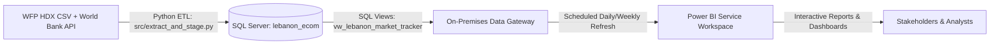

# 🇱🇧 📊 Lebanon Market & Economic Tracker: Power BI Enterprise Dashboard Guide
**Author / Role:** Senior Data Analyst & BI Architect  
**Project:** `lebanon-market-tracker`  
**Target Environment:** Microsoft Power BI Desktop & Power BI Service  
**Data Sources:** Microsoft SQL Server (`lebanon_ecom`) — UN WFP Food Prices & World Bank Macro Indicators

---

## 1. Executive Summary & Dashboard Architecture

The **Lebanon Market & Economic Tracker Dashboard** is designed to provide humanitarian organizations, economic researchers, and policymakers with actionable visibility into food security, hyperinflation, regional price disparities, and currency depreciation in Lebanon between **2012 and 2026**.

### 1.1 Source Views in SQL Server (`lebanon_ecom`)
1. **`dbo.vw_lebanon_market_tracker`** (~38,786 rows):
   - Granularity: Monthly observation per commodity, unit, market, district, and governorate.
   - Core fields: `observation_month`, `observation_date`, `governorate`, `district`, `market`, `latitude`, `longitude`, `category`, `commodity`, `unit`, `pricetype`, `price_local` (LBP), `price_usd` (USD).
2. **`dbo.vw_world_bank_macro`** (35+ years):
   - Granularity: Annual macroeconomic indicators.
   - Core fields: `year`, `cpi_inflation_annual_pct`, `unemployment_rate_pct`.

---

## 2. Power BI Data Modeling & Star Schema

To ensure optimal VertiPaq compression, lightning-fast DAX calculations, and clean visual filtering, implement a **Star Schema** model.

```
       ┌────────────────────────┐         ┌────────────────────────┐
       │      Dim_Calendar      │         │     Dim_Commodity      │
       ├────────────────────────┤         ├────────────────────────┤
       │ DateKey (PK)           │         │ CommodityKey (PK)      │
       │ Date, Year, Month, etc.│         │ Category, Commodity    │
       └───────────┬────────────┘         └───────────┬────────────┘
                   │ 1                                │ 1
                   │                                  │
                   │ *                                │ *
         ┌─────────┴──────────────────────────────────┴─────────┐
         │              Fact_MarketPrices (WFP)                  │
         ├───────────────────────────────────────────────────────┤
         │ DateKey (FK)                                          │
         │ LocationKey (FK)                                      │
         │ CommodityKey (FK)                                     │
         │ Price_Local (LBP), Price_USD ($)                      │
         │ Unit, PriceType                                       │
         └─────────┬─────────────────────────────────────────────┘
                   │ *
                   │ 
                   │ 1
       ┌───────────┴────────────┐         ┌────────────────────────┐
       │      Dim_Location      │         │  Fact_MacroIndicators  │
       ├────────────────────────┤         ├────────────────────────┤
       │ LocationKey (PK)       │         │ Year (FK)              │
       │ Governorate, District  │         │ CPI_Inflation_Pct      │
       │ Market, Lat, Long      │         │ Unemployment_Rate_Pct  │
       └────────────────────────┘         └────────────────────────┘
```

### 2.1 Power Query (M) Setup Steps
1. **Get Data** $\rightarrow$ **SQL Server Database**:
   - Server: `localhost` (or your configured SQL Server name).
   - Database: `lebanon_ecom`.
   - Data Connectivity mode: **Import** (Recommended for performance and full DAX time-intelligence features).
2. Select views:
   - `dbo.vw_lebanon_market_tracker` $\rightarrow$ Rename query to `Fact_MarketPrices`.
   - `dbo.vw_world_bank_macro` $\rightarrow$ Rename query to `Fact_MacroIndicators`.
3. **Data Type Verification**:
   - `observation_month`: `Date`
   - `observation_date`: `Date`
   - `price_local`: `Decimal Number` / `Currency`
   - `price_usd`: `Decimal Number`
   - `latitude`, `longitude`: `Decimal Number` (Set Data Category to Latitude / Longitude in Power BI Data view).
   - `year`, `cpi_inflation_annual_pct`, `unemployment_rate_pct`: Numeric types.

### 2.2 Model Relationships Table
| From (Fact Table) | Column (FK) | To (Dimension Table) | Column (PK) | Cardinality | Cross Filter |
| :--- | :--- | :--- | :--- | :--- | :--- |
| `Fact_MarketPrices` | `observation_month` | `Dim_Calendar` | `Date` | Many to One (`*:1`) | Single |
| `Fact_MacroIndicators` | `year` | `Dim_Calendar` | `Year` | Many to One (`*:1`) | Single (Inactive or bridged via Year) |
| `Fact_MarketPrices` | `commodity` | `Dim_Commodity` | `commodity` | Many to One (`*:1`) | Single |
| `Fact_MarketPrices` | `market` | `Dim_Location` | `market` | Many to One (`*:1`) | Single |

---

## 3. Comprehensive DAX Measure Library

Create a dedicated empty table named `_Measures` to store all calculations organized in display folders.

### 3.1 Date Table DAX (Calculated Table)
Create this table first under **Modeling $\rightarrow$ New Table**:
```dax
Dim_Calendar = 
VAR MinYear = YEAR(MIN(Fact_MarketPrices[observation_month]))
VAR MaxYear = YEAR(MAX(Fact_MarketPrices[observation_month]))
RETURN
ADDCOLUMNS (
    CALENDAR(DATE(MinYear, 1, 1), DATE(MaxYear, 12, 31)),
    "Year", YEAR([Date]),
    "Year-Quarter", FORMAT([Date], "YYYY-\QQ"),
    "Month Number", MONTH([Date]),
    "Month Name", FORMAT([Date], "MMMM"),
    "Month Short", FORMAT([Date], "MMM"),
    "Year-Month", FORMAT([Date], "YYYY-MM"),
    "Year-Month Sort", YEAR([Date]) * 100 + MONTH([Date]),
    "Month Start", DATE(YEAR([Date]), MONTH([Date]), 1),
    "Quarter", "Q" & FORMAT([Date], "Q")
)
```
> **Action:** Mark `Dim_Calendar` as a Date Table and sort `Month Short` and `Year-Month` by `Year-Month Sort`.

---

### 3.2 Base Core Metrics
```dax
// Total count of price collection entries
Total Observations = COUNTROWS(Fact_MarketPrices)

// Average Price in USD
Avg Price (USD) = 
AVERAGE(Fact_MarketPrices[price_usd])

// Average Price in Lebanese Pounds
Avg Price (LBP) = 
AVERAGE(Fact_MarketPrices[price_local])

// Minimum and Maximum USD Prices
Min Price (USD) = MIN(Fact_MarketPrices[price_usd])
Max Price (USD) = MAX(Fact_MarketPrices[price_usd])

// Implicit Exchange Rate calculated from commodity prices (LBP per 1 USD)
Implicit Exchange Rate (LBP/USD) = 
DIVIDE(
    SUM(Fact_MarketPrices[price_local]),
    SUM(Fact_MarketPrices[price_usd]),
    BLANK()
)

// Active Distinct Dimension Counts
Distinct Commodities Tracked = DISTINCTCOUNT(Fact_MarketPrices[commodity])
Distinct Markets Active = DISTINCTCOUNT(Fact_MarketPrices[market])
Distinct Governorates = DISTINCTCOUNT(Fact_MarketPrices[governorate])
```

---

### 3.3 Time Intelligence & Growth Measures (MoM & YoY)
```dax
// Previous Month Average USD Price
Avg Price (USD) PM = 
CALCULATE(
    [Avg Price (USD)],
    DATEADD(Dim_Calendar[Month Start], -1, MONTH)
)

// Month-over-Month (MoM) Price Change ($)
Price Change USD MoM = 
VAR CurrentPrice = [Avg Price (USD)]
VAR PrevPrice = [Avg Price (USD) PM]
RETURN
IF(NOT ISBLANK(PrevPrice), CurrentPrice - PrevPrice, BLANK())

// Month-over-Month (MoM) % Growth
Avg Price (USD) MoM % = 
DIVIDE([Price Change USD MoM], [Avg Price (USD) PM], BLANK())

// Previous Month Average LBP Price
Avg Price (LBP) PM = 
CALCULATE(
    [Avg Price (LBP)],
    DATEADD(Dim_Calendar[Month Start], -1, MONTH)
)

// LBP Price MoM % Growth
Avg Price (LBP) MoM % = 
DIVIDE([Avg Price (LBP)] - [Avg Price (LBP) PM], [Avg Price (LBP) PM], BLANK())

// Year-over-Year (YoY) Average USD Price
Avg Price (USD) PY = 
CALCULATE(
    [Avg Price (USD)],
    SAMEPERIODLASTYEAR(Dim_Calendar[Date])
)

// Year-over-Year (YoY) % Growth
Avg Price (USD) YoY % = 
DIVIDE([Avg Price (USD)] - [Avg Price (USD) PY], [Avg Price (USD) PY], BLANK())

// Exchange Rate MoM % Depreciation
Exchange Rate MoM % = 
VAR CurrentRate = [Implicit Exchange Rate (LBP/USD)]
VAR PrevRate = CALCULATE([Implicit Exchange Rate (LBP/USD)], DATEADD(Dim_Calendar[Month Start], -1, MONTH))
RETURN
DIVIDE(CurrentRate - PrevRate, PrevRate, BLANK())
```

---

### 3.4 Essential Food Basket & Vulnerability Metrics
```dax
// Standard Monthly Food Basket in USD (Weighted aggregation across key food categories)
Food Basket Cost (USD) = 
CALCULATE(
    SUMX(
        VALUES(Fact_MarketPrices[commodity]),
        [Avg Price (USD)]
    ),
    Fact_MarketPrices[category] IN {
        "cereals and tubers",
        "pulses",
        "vegetables",
        "meat, fish and eggs",
        "oil and fats",
        "milk and dairy"
    }
)

// Standard Monthly Food Basket in LBP
Food Basket Cost (LBP) = 
CALCULATE(
    SUMX(
        VALUES(Fact_MarketPrices[commodity]),
        [Avg Price (LBP)]
    ),
    Fact_MarketPrices[category] IN {
        "cereals and tubers",
        "pulses",
        "vegetables",
        "meat, fish and eggs",
        "oil and fats",
        "milk and dairy"
    }
)

// National Average Price Benchmark (Ignores Regional Filters for Disparity Analysis)
National Avg Price (USD) = 
CALCULATE(
    [Avg Price (USD)],
    ALL(Fact_MarketPrices[governorate]),
    ALL(Fact_MarketPrices[district]),
    ALL(Fact_MarketPrices[market])
)

// Regional Price Variance % vs National Benchmark
Regional Price Variance % = 
DIVIDE(
    [Avg Price (USD)] - [National Avg Price (USD)],
    [National Avg Price (USD)],
    0
)

// Volatility Index (Standard Deviation / Mean Price)
Price Volatility Index = 
DIVIDE(
    STDEV.P(Fact_MarketPrices[price_usd]),
    [Avg Price (USD)],
    0
)
```

---

### 3.5 Macroeconomic Linkage Measures
```dax
// CPI Inflation Rate from World Bank
Annual CPI Inflation Rate % = 
AVERAGE(Fact_MacroIndicators[cpi_inflation_annual_pct])

// Total Unemployment Rate from World Bank
Unemployment Rate % = 
AVERAGE(Fact_MacroIndicators[unemployment_rate_pct])

// Dynamic Title with Selection Context
Dynamic Dashboard Title = 
VAR SelectedCategory = SELECTEDVALUE(Fact_MarketPrices[category], "All Categories")
VAR SelectedGov = SELECTEDVALUE(Fact_MarketPrices[governorate], "Lebanon (National)")
RETURN
"Lebanon Market & Price Dynamics | " & SelectedGov & " | " & SelectedCategory
```

---

## 4. UI/UX Design System & Color Palette

To deliver an executive-grade dashboard, adhere to this design standard:

| Element | Hex Code | Semantic Role |
| :--- | :--- | :--- |
| **Primary Brand (Cedar Green)** | `#006837` | Main headers, active filters, healthy indicators |
| **Crisis / Alert Red** | `#C0392B` | High inflation, price surges, critical volatility |
| **Secondary Accent (Amber/Gold)** | `#F39C12` | Warnings, moderate price increases |
| **Deep Dark Slate** | `#1E293B` | Card metrics, chart titles, axis labels |
| **Muted Slate Gray** | `#64748B` | Subtitles, gridlines, axis ticks |
| **Neutral Background** | `#F8FAFC` | Canvas background |
| **Card Container Background** | `#FFFFFF` | Visual containers with 8px corner radius & light shadow |

* **Canvas Dimensions:** 16:9 widescreen (`1920 x 1080 px` or `1280 x 720 px`).
* **Typography:** `Segoe UI` or `Segoe UI Semibold` throughout for clean numerical legibility.

---

## 5. Step-by-Step Visuals Setup Guide (4-Page Blueprint)

---

### 📄 Page 1: Executive Overview & Macroeconomic Health
*Goal: Provide leadership with an instant pulse on national food inflation, currency exchange rate collapse, and macro trends.*

```
+----------------------------------------------------------------------------------------------------+
| [LOGO] LEBANON MARKET & ECONOMIC TRACKER (2012-2026)             [Gov Filter] [Date Slicer] [Reset]|
+----------------------------------------------------------------------------------------------------+
|  [ KPI 1: Avg Food Basket ]   [ KPI 2: Avg Price (USD) ]   [ KPI 3: LBP Rate ]  [ KPI 4: Inflation%]|
|     $42.50  (+3.2% MoM)          $2.85  (-1.1% MoM)          89,500 LBP/USD        221.3% (WB)     |
+-------------------------------------------------------------+--------------------------------------+
| VISUAL 1: Price Trends vs Macro CPI Inflation (Combo Chart) | VISUAL 2: Geographic Market Map      |
|  - Columns: Food Basket Cost (USD)                          |  - Map of Lebanon with bubbles       |
|  - Line: World Bank Annual Inflation %                      |  - Size: Total Observations          |
|                                                             |  - Color: Avg Price (USD)            |
+-------------------------------------------------------------+--------------------------------------+
| VISUAL 3: Top 10 Commodities with Highest YoY Price Surges  | VISUAL 4: Category Inflation Share   |
|  - Horizontal Bar Chart (Sorted Descending)                 |  - Donut Chart / Treemap             |
+----------------------------------------------------------------------------------------------------+
```

#### Step-by-Step Configuration for Page 1:
1. **Header Slicers Panel (Top Banner)**:
   - Visual Type: **Slicer (Dropdown / Horizontal Tiles)**
   - Fields: `Dim_Calendar[Year]`, `Fact_MarketPrices[governorate]`, `Fact_MarketPrices[category]`.
2. **KPI 1 (New Card Visual)**:
   - Field: `[Food Basket Cost (USD)]`
   - Secondary Callout / Reference Label: `[Avg Price (USD) MoM %]`
   - Conditional Formatting: Green if `< 0`, Red if `> 0`.
3. **KPI 2 (New Card Visual)**:
   - Field: `[Avg Price (USD)]`
   - Secondary Callout: `[Avg Price (USD) YoY %]`
4. **KPI 3 (New Card Visual)**:
   - Field: `[Implicit Exchange Rate (LBP/USD)]`
   - Secondary Callout: `[Exchange Rate MoM %]`
5. **KPI 4 (New Card Visual)**:
   - Field: `[Annual CPI Inflation Rate %]`
   - Context: "World Bank National Indicator"
6. **Visual 1: Macro vs Food Inflation Over Time (Line and Clustered Column Chart)**:
   - **X-Axis:** `Dim_Calendar[Month Start]` (or `Year`)
   - **Column Y-Axis:** `[Avg Price (USD)]` or `[Food Basket Cost (USD)]`
   - **Line Y-Axis:** `[Annual CPI Inflation Rate %]`
   - Format: Column color `#006837`, Line color `#C0392B` (Stroke width: 3). Enable Data Labels on Hover (Tooltips).
7. **Visual 2: National Market Distribution Map (Azure Map / Shape Map / Bubble Map)**:
   - **Location:** `Fact_MarketPrices[governorate]`, `Fact_MarketPrices[district]`
   - **Latitude:** `Fact_MarketPrices[latitude]`
   - **Longitude:** `Fact_MarketPrices[longitude]`
   - **Bubble Size:** `[Total Observations]`
   - **Bubble Color:** `[Avg Price (USD)]` (Diverging gradient: Green $\rightarrow$ Yellow $\rightarrow$ Red).
8. **Visual 3: Top Surging Commodities (Clustered Bar Chart)**:
   - **Y-Axis:** `Fact_MarketPrices[commodity]` (Top 10 filter by `[Avg Price (USD) YoY %]`)
   - **X-Axis:** `[Avg Price (USD) YoY %]`
   - **Data Labels:** ON (Format as percentage `+0.0%`).

---

### 📄 Page 2: Commodity Dynamics & Volatility Deep-Dive
*Goal: Allow category managers and procurement analysts to drill into specific food baskets, units, and price distributions.*

```
+----------------------------------------------------------------------------------------------------+
| COMMODITY PRICE DRILL-DOWN & VOLATILITY MATRIX                     [Category Slicer] [PriceType]   |
+----------------------------------------------------------------------------------------------------+
| VISUAL 1: Multi-Commodity Historical Price Trajectory (USD vs LBP)                                 |
|  - Line Chart with Category Hierarchy & Commodity Legend                                           |
|  - Tooltip: Min Price, Max Price, Unit, Volatility Index                                           |
+-------------------------------------------------------------+--------------------------------------+
| VISUAL 2: Price Volatility & Spread (Box / Scatter Plot)     | VISUAL 3: Commodity Heatmap Matrix   |
|  - X-Axis: Category                                         |  - Rows: Category > Commodity        |
|  - Y-Axis: Avg Price (USD)                                  |  - Columns: Year / Quarter           |
|  - Bubble / Dots: Commodity Price Spread                    |  - Values: MoM % (Conditional Color) |
+-------------------------------------------------------------+--------------------------------------+
| VISUAL 4: Retail vs Wholesale Price Margin Analysis                                                |
|  - Clustered Column Chart comparing PriceType (Retail vs Wholesale)                                 |
+----------------------------------------------------------------------------------------------------+
```

#### Step-by-Step Configuration for Page 2:
1. **Visual 1: Historical Commodity Trajectory (Line Chart)**:
   - **X-Axis:** `Dim_Calendar[Month Start]`
   - **Y-Axis:** `[Avg Price (USD)]` (or toggle to LBP via Field Parameter)
   - **Legend:** `Fact_MarketPrices[commodity]`
   - **Tooltips:** `[Min Price (USD)]`, `[Max Price (USD)]`, `[Price Volatility Index]`, `[Implicit Exchange Rate (LBP/USD)]`.
2. **Visual 2: Category Volatility Matrix (Matrix Visual)**:
   - **Rows:** `Fact_MarketPrices[category]`, `Fact_MarketPrices[commodity]`, `Fact_MarketPrices[unit]`
   - **Columns:** `Dim_Calendar[Year]`
   - **Values:** `[Avg Price (USD)]`, `[Avg Price (USD) YoY %]`
   - **Conditional Formatting:** Background color on `[Avg Price (USD) YoY %]` (Red for positive surge, Green for decrease).
3. **Visual 3: Price Spread by Category (Scatter / Box Plot Visual)**:
   - **X-Axis:** `Fact_MarketPrices[category]`
   - **Y-Axis:** `[Avg Price (USD)]`
   - **Details:** `Fact_MarketPrices[commodity]`
   - **Size:** `[Total Observations]`
4. **Visual 4: Retail vs Wholesale Price Comparison (Clustered Column Chart)**:
   - **X-Axis:** `Fact_MarketPrices[category]`
   - **Y-Axis:** `[Avg Price (USD)]`
   - **Legend:** `Fact_MarketPrices[pricetype]` (Retail vs Wholesale)

---

### 📄 Page 3: Regional & Governorate Disparity Analysis
*Goal: Identify geographic vulnerabilities and transport/supply-chain cost premiums across governorates (e.g., Akkar vs Beirut vs Bekaa).*

```
+----------------------------------------------------------------------------------------------------+
| REGIONAL DISPARITIES & MARKET ACCESSIBILITY                        [Commodity Slicer] [Unit Slicer]|
+----------------------------------------------------------------------------------------------------+
| VISUAL 1: Regional Price Premium vs National Benchmark (%)                                        |
|  - Tornado / Bar Chart: % Variance above/below National Average                                    |
+-------------------------------------------------------------+--------------------------------------+
| VISUAL 2: District-Level Price Comparison (Matrix / Table)  | VISUAL 3: Geographic Distribution Map|
|  - Governorate | District | Avg USD | % vs Benchmark | Obs   |  - Bubble Map pinpointing all local  |
|  - Heatmap formatted cells                                  |    markets with price flags          |
+-------------------------------------------------------------+--------------------------------------+
```

#### Step-by-Step Configuration for Page 3:
1. **Visual 1: Regional Price Premium vs National Benchmark (Clustered Bar Chart)**:
   - **Y-Axis:** `Fact_MarketPrices[governorate]`
   - **X-Axis:** `[Regional Price Variance %]`
   - **Data Colors:** Rule-based conditional color:
     - If Value $\ge 0$: Crisis Red (`#C0392B`) $\rightarrow$ Region is paying above national average.
     - If Value $< 0$: Cedar Green (`#006837`) $\rightarrow$ Region is cheaper than national average.
2. **Visual 2: District Breakdown Matrix**:
   - **Rows:** `Fact_MarketPrices[governorate]`, `Fact_MarketPrices[district]`, `Fact_MarketPrices[market]`
   - **Values:** `[Avg Price (USD)]`, `[Avg Price (LBP)]`, `[Regional Price Variance %]`, `[Total Observations]`
   - **Subtotals:** Enabled at Governorate level.
3. **Visual 3: Market Map with Price Flags**:
   - **Latitude & Longitude:** Bound to location fields.
   - **Tooltips:** Market Name, District, Governorate, Latest Food Basket Cost.

---

### 📄 Page 4: Currency Crisis, Inflation & Purchasing Power (2019-2026 Collapse)
*Goal: Dedicated macroeconomic timeline tracking the unpegging of the Lebanese Pound from 1,507.5 to open market rates and its direct impact on food affordability.*

```
+----------------------------------------------------------------------------------------------------+
| CURRENCY DEPRECIATION & PURCHASING POWER COLLAPSE                  [Timeline: 2019 - 2026 Zoom]    |
+----------------------------------------------------------------------------------------------------+
| VISUAL 1: The Currency Collapse Trajectory (Log/Linear Line Chart)                                 |
|  - Line: Implicit Exchange Rate (LBP/USD) surging from 1,500 to 89,500+                            |
|  - Annotation Markers: 2019 Crisis Start, 2020 Beirut Port Explosion, 2023 Official Re-peg         |
+-------------------------------------------------------------+--------------------------------------+
| VISUAL 2: Purchasing Power Erosion (Local vs USD Prices)    | VISUAL 3: Macroeconomic Correlation  |
|  - Dual Line: Avg Price in LBP (10,000x) vs USD Stability   |  - Scatter Plot: Inflation% vs LBP % |
+----------------------------------------------------------------------------------------------------+
```

#### Step-by-Step Configuration for Page 4:
1. **Visual 1: Currency Depreciation Curve (Area / Line Chart)**:
   - **X-Axis:** `Dim_Calendar[Month Start]` (Filtered from 2019 onwards)
   - **Y-Axis:** `[Implicit Exchange Rate (LBP/USD)]`
   - **Format:** Area fill with gradient red to highlight hyper-depreciation.
2. **Visual 2: Price in LBP vs USD (Dual Axis Chart)**:
   - **X-Axis:** `Dim_Calendar[Month Start]`
   - **Y-Axis (Left - USD):** `[Avg Price (USD)]`
   - **Y-Axis (Right - LBP):** `[Avg Price (LBP)]`
   - Demonstrates the "dollarization" phenomenon where USD food prices stabilized while LBP prices inflated exponentially.
3. **Visual 3: Macro Indicators Table**:
   - **Columns:** `Dim_Calendar[Year]`, `[Annual CPI Inflation Rate %]`, `[Unemployment Rate %]`, `[Implicit Exchange Rate (LBP/USD)]`, `[Food Basket Cost (USD)]`.

---

## 6. Advanced Power BI Features to Implement

### 6.1 Dynamic Currency Parameter (LBP $\leftrightarrow$ USD Toggle)
Allow users to switch all dashboard charts between USD and LBP seamlessly:
1. Go to **Modeling $\rightarrow$ New Parameter $\rightarrow$ Fields**.
2. Select `[Avg Price (USD)]` and `[Avg Price (LBP)]`.
3. Name parameter: `Currency Selector`.
4. Use `Currency Selector[Currency Selector]` in chart Y-Axes and slicers.

### 6.2 Drill-Through Page Setup
1. Create a dedicated page: **Commodity 360 Drillthrough**.
2. Drag `Fact_MarketPrices[commodity]` into the **Drill-through fields** well.
3. When a user right-clicks any bar/line in the overview $\rightarrow$ **Drill through $\rightarrow$ Commodity 360**, it filters specifically for that item across all historical markets.

### 6.3 Tooltip Report Page
1. Create a mini page (Canvas size: `320 x 240 px`), set **Page Type** to **Tooltip**.
2. Add a mini sparkline of `[Avg Price (USD)]` over the last 12 months and a gauge of `[Regional Price Variance %]`.
3. Link this tooltip page to Visual 2 (Market Map) on Page 1.

---

## 7. Power BI Service Deployment & Automated Refresh



### 7.1 Automated Refresh Pipeline
1. **Local ETL:** `run_pipeline.bat` automatically triggers `extract_and_stage.py`, refreshing staging tables and views.
2. **Gateway:** Configure the **On-Premises Data Gateway (Standard Mode)** on the SQL Server machine.
3. **Data Source Credentials:** In Power BI Service, set connection to `localhost` / `lebanon_ecom` with Windows Authentication.
4. **Scheduled Refresh:** Schedule daily/weekly refresh 1 hour after the Python ETL cron execution.

---

## 8. Summary Checklist for Implementation

- [ ] Connect Power BI to `dbo.vw_lebanon_market_tracker` and `dbo.vw_world_bank_macro`.
- [ ] Generate `Dim_Calendar` calculated table and build 1-to-many relationships.
- [ ] Create `_Measures` table and copy-paste all DAX measures (Core, Time-Intelligence, Food Basket, Macro).
- [ ] Set column data categories for `latitude` and `longitude`.
- [ ] Build Page 1: Executive Overview with 4 KPI cards, macro combo chart, and market map.
- [ ] Build Page 2: Commodity deep-dive matrix with conditional formatting heatmaps.
- [ ] Build Page 3: Regional price disparity variance chart vs national benchmark.
- [ ] Build Page 4: Currency crisis & purchasing power collapse timeline.
- [ ] Test cross-filtering, slicer interactions, and drill-through workflows.
- [ ] Save `.pbix` file in the `powerbi/` folder and publish to workspace.

